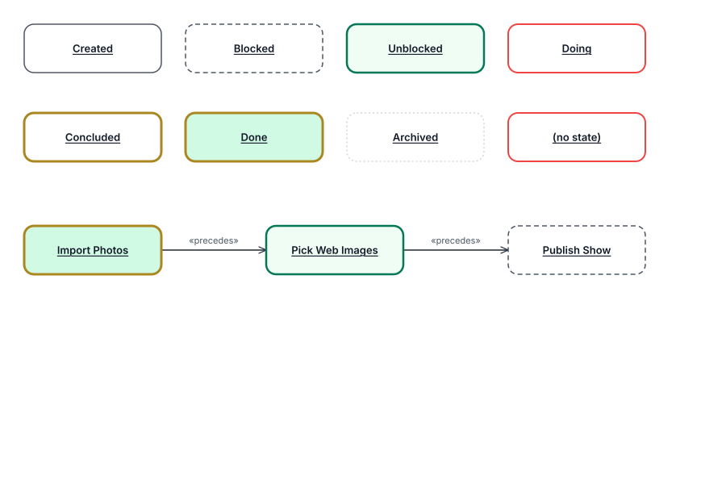

# RaidCanvas 0.13.0 — Activities show their lifecycle state

Date: 2026-10-16 · Package: `@dr2rai/raid-canvas@0.13.0`

Published to npm by RAI on 2026-10-17 (tag `v0.13.0` at `49be301`), on RAI's and Adele's go. Asked for in `AIA/doc/PROMPT_ALAN_WORKBENCH_ACTIVITY_EXEC_UI.md` (Adele and RAI): after **Run Exec**, the Activity shows `Done`, and a «precedes» successor whose precondition the run satisfied shows ready. aia-workbench (`c931ecf`) already sends each Activity's live state from the engine's evaluation as `aim-state`; with 0.12.0 it is carried but not drawn.

## Changes

- **Activity states (`ActivityStates.ts`).** One table, read by the live canvas and the export:

  | `aim-state` | Fill | Frame |
  |---|---|---|
  | `Created` | white | Graphite, 1.5 |
  | `Blocked` | white | Graphite, 1.5, dashed `6,4` |
  | `Unblocked` (or `Ready`) | Emerald Whisper | Emerald Deep, 2.5 |
  | `Doing`, or no state | white | Cascais Red, 2 (as before) |
  | `Concluded` | white | Net Gold, 3 |
  | `Done` | Emerald Pale | Net Gold, 3 |
  | `Archived` | white | Silver, 1.5, dotted `2,3` |

  

- **Status colours, not the flag.** A state is status, so it uses the Emerald family and Net Gold, never Heraldic Green or Vermelho, which belong to the Persona/Portal duality. A test checks that no state borrows them.
- **Not by colour alone.** Blocked is dashed and Archived dotted; the finished states carry a heavier gold frame. The export names the state in a `<title>` on the Activity's frame.
- An Activity without `aim-state`, and every other kind of node, is drawn exactly as in 0.12.0.
- Exports: `ACTIVITY_STATE_LOOKS`, `ACTIVITY_DEFAULT_LOOK`, `activityLookOf`, `ActivityLook`.

## Tests

`test/activityStates.test.mjs` (5), and `pnpm test` now also runs the edge-grammar, Shape-element and role-slot suites, which had been run only by hand: 205 tests, all passing.
